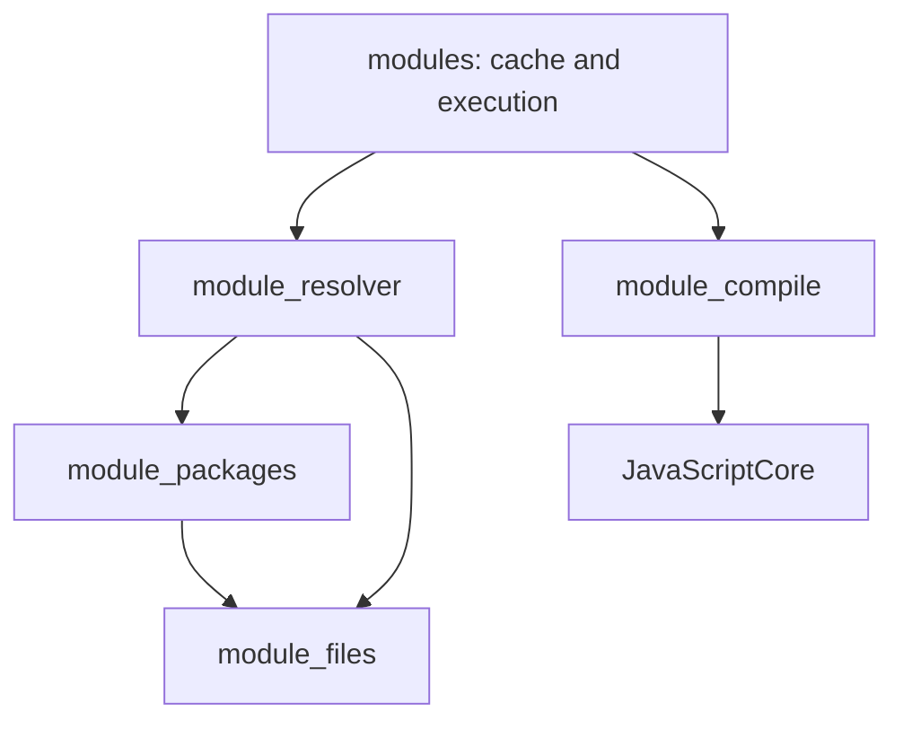

# 코드 구조 안내

http_headers.wave는 응답 헤더의 조회/제거/확정을 맡고 querystring.wave는 기존 Wave form decoder를 재사용한다.
process_events.wave의 신호 콜백은 native 표식만 갱신한다. Wave event_loop가 소유 스레드에서 이벤트를
전달하며, watcher는 구독만으로 프로세스를 유지하지 않는다. stdio는 기존 Writable과 descriptor write를 쓴다.
Worker ABI v2의 VM 마지막 해제/RunLoop 정리는 worker_run.wave가 소유 스레드 종료 전에 요청한다.
tools/linux_check.wave가 고정 rootfs/PRoot와 별도 시스템 의존성 검사를 조정한다.

패키지 호환 입력은 tests/npm_compat.*이며 tests/suites/package_registry.wave가 frozen 설치·실행·정리를 맡는다.
test.wave는 tests/suites/runner.wave의 호출만 맡고, 공통 집계와 출력 수집은 harness.wave에 둔다.
runtime/stream_text.wave는 UTF-8 증분 문자열 큐를 담당한다.
tools/soak.wave는 혼합 부하 프로세스와 자원 측정을 소유한다. 런타임 CPU 제한이 아니다.
tools/release.wave는 검증된 상대 RUNPATH 묶음을 조립한다. tools/deploy.wave는 얇은 진입점,
deploy_app.wave는 설치 정책, release_files.wave와 private_files.wave는 파일 검증/복사/정리를 맡는다.

실행·모듈 해석·JSON·스트림 정책은 Wave에 있다. JavaScriptCore는 JS 실행과 GC/JIT를 맡고,
C/C++은 엔진·네이티브 라이브러리 ABI를 연결한다.

## 실행 흐름

file_handles.wave가 FileHandle 슬롯·직렬 요청·Promise·close 수명을 관리한다.
fs_handle_jobs.wave는 공유 Wave 파일 큐에서 실행하는 네이티브 작업과 소유 스레드 결과 변환을 나눈다.
system.wave는 일반 파일 옵션과 공통 FileWork를 유지한다. 호스트 종료는 파일 작업자 join 뒤
FileHandle/파일 스트림의 descriptor를 정리한다.

stream_transform.wave는 변환/flush 콜백과 읽기 압력을 처리한다. 객체/바이트 큐의 크기와 모드는
stream_state.wave, 공통 큐 조작은 stream_operations.wave, 읽기·쓰기는 기존 담당 모듈에 둔다.
package_graph.wave는 JSON 문서 수명과 독립적인 패키지/peer/생략 문자열·체크포인트를 소유하며,
package_install.wave가 optional/peer 정책을, package_io.wave가 생성 경로 ledger의 롤백을 맡는다.

`main.wave → app.wave → session.wave`가 명령과 실행 수명을 관리한다.
`host.wave`는 API 설치·종료 순서, `event_loop.wave`는 준비된 작업의 실행과 대기를 조율한다.
기능을 수정할 때는 아래 담당 모듈부터 읽으면 된다.

HTTP 서버의 IncomingMessage/ServerResponse는 일반 스트림의 자동 파괴를 사용하지 않는다.
요청 EOF와 응답 finish는 메시지 완료이며 공유 소켓의 파괴가 아니다. 정상 close/recycle은
HTTP 연결 수명 관리가 맡고, 명시적 destroy와 오류는 기존 HTTP destroy 훅으로 전달한다.

| 파일 | 확장 기능의 책임 |
| --- | --- |
| `runtime/next_tick.wave` | 컨텍스트별 nextTick FIFO·인자 rooting·소비·종료 |
| `native/c/engine_jsc.c` | 일반 엔진 진입을 네이티브 콜백으로 감싸는 ABI; nextTick 처리는 Wave, Promise 체크포인트는 JSC |
| `runtime/process_io.wave` | stdin/자식 파이프의 nonblocking 전송·역압력·FD 소유권·정리 |
| `runtime/child_process.wave` | spawn 옵션·파일 동작·소유 PID 회수와 exit/close 순서 |
| `runtime/stream_options.wave` | 생성자 취소 신호와 중첩 cork 정책 |
| `runtime/web_objects.wave` | Blob·버퍼 Request/Response·clone·wjson JSON·fetch 입력 스냅샷 |
| `runtime/form_data.wave` | private 필드 목록·Blob 참조·multipart 경계/인코딩 |
| `runtime/web_support.wave`, `text_codec.wave` | 캡처한 Web 변환 intrinsic·BufferSource 스냅샷·UTF-8 codec |
| `runtime/web_events.wave` | EventTarget listener 상태·dispatch·AbortSignal 공통 이벤트 기반 |
| `runtime/abort_state.wave` | EventTarget·Abort API가 공유하는 컨텍스트별 취소 상태·구독; 상위 API를 import하지 않음 |
| `runtime/web_stream_core.wave`, `web_readable.wave`, `web_writable.wave` | Web stream 상태·JSC Promise capability·default source/sink |
| `runtime/web_transform.wave`, `web_composition.wave`, `web_stream_adapter.wave` | 변환 역압력·pipe/tee/반복·호스트 Readable 연결 |
| `runtime/json_source.wave` | wjson 검증 뒤 reviver의 원문 span·초기 값 대응 |
| `runtime/package_workspaces.wave` | 프로젝트 descriptor 기반 workspace 발견·원본 무결성·관리 스냅샷 복사 |
| `runtime/package_versions.wave` | 일반 범위와 공유 부모 범위의 peer 교집합 버전 선택 |

Abort 의존 방향은 `abort → web_events → abort_state`와 `abort → abort_state`다.
이전의 취소 상태 C ABI 우회 함수는 제거했다. 취소 알고리즘 우선순위·WeakMap 소유권과
EventTarget 설치 후 AbortSignal 상속을 연결하는 순서는 유지한다.
일반 생성자는 native/c/engine_jsc.c의 jsrt_create_callable_constructor를 공통으로 사용한다.
Worker 수명 정책과 Web의 new 호출 규칙은 각 Wave 모듈에 남는다.

## CommonJS

| 파일 | 책임 |
| --- | --- |
| `runtime/modules.wave` | require 진입, 캐시, 실행, 메타데이터와 전체 수명 |
| `runtime/module_state.wave` | 컨텍스트별 레코드·공통 자료형·경로 한도 |
| `runtime/module_support.wave` | JS 속성·오류·파일 위치 표시·내장 모듈 이름 |
| `runtime/module_files.wave` | 실제 파일 탐색, 확장자, package main과 index |
| `runtime/module_packages.wave` | exports/imports 대상 선택, 패턴·조건·fallback, 패키지 범위 |
| `runtime/module_resolver.wave` | 부모 기준 경로, package imports·자기 참조·node_modules 탐색 |
| `runtime/module_compile.wave` | BOM/hashbang/NUL 처리와 JSC 함수 컴파일 |

경로 해석 단계에서는 JS 모듈 본문을 실행하지 않는다. 실행·캐시·실패한 레코드 처리는
`modules.wave`가 맡는다. 패키지 imports의 재귀 탐색은 resolver 안에 두어 역방향 import를 피한다.
ESM은 `esm.wave`가 같은 resolver를 `import` 조건으로 호출한다. 실행 중 CommonJS 해석으로
정책이 새지 않도록 동기 해석이 끝나면 이전 조건을 복구한다. `native/cpp/jsc_module_api.cpp`는
일치하는 엔진 소스 안에서 컴파일하며 JSC의 그래프·평가·Promise를 연결한다.
`esm_interop.wave`는 내장 모듈의 export 목록과 CJS 지연 평가 콜백, wjson JSON 값을 준비한다.
추가 엔진 패치가 이를 JSC의 synthetic 모듈 환경·캐시·평가 순서에 연결한다.
`esm_files.wave`는 로컬 file URL 검증과 UTF-8 경로 복원을 담당한다.

## JSON

| 파일 | 책임 |
| --- | --- |
| `runtime/json.wave` | intrinsic 설치·해제와 C 콜백 진입 |
| `runtime/json_support.wave` | 컨텍스트별 intrinsic 조회, JS 호출·속성·오류·한도 |
| `runtime/json_parse.wave` | wjson 파싱, JS 값 생성과 reviver 순회 |
| `runtime/json_stringify.wave` | replacer·toJSON·순환 참조·wjson 직렬화 |
| `runtime/json_format.wave` | 직렬화 결과의 들여쓰기 |
| `runtime/wjson_text.wave` | JS UTF-16과 wjson UTF-8 사이의 문자열 변환 |

parse와 stringify는 같은 캡처 함수와 컨텍스트 슬롯을 사용한다.
엔진 JSON 메서드로의 fallback이나 JS bootstrap을 추가하지 않는다.

## 바이트 스트림

| 파일 | 책임 |
| --- | --- |
| `runtime/streams.wave` | 생성자·C 콜백 연결·API 등록·호스트 진입 |
| `runtime/stream_state.wave` | private 상태·브랜드·생성 옵션·수명 |
| `runtime/stream_operations.wave` | 공통 큐·작업 예약·역압력·destroy 요청 |
| `runtime/stream_readable.wave` | 읽기·흐름 제어·pipe·EOF 처리 |
| `runtime/stream_writable.wave` | 쓰기 큐·직렬 완료·finish 처리 |
| `runtime/stream_lifecycle.wave` | close·자원 훅 완료·상태 getter |
| `runtime/stream_utils.wave` | finished·pipeline·취소 연결 |
| `runtime/file_streams.wave` | 파일 descriptor와 작업 스레드 연결 |

Readable의 pipe는 Writable의 쓰기 처리를 호출한다. Writable은 공통 operations만 사용하므로
두 모듈이 서로 import하지 않는다. JS 호출은 소유 JSC 스레드에서 처리하며,
파일 작업자를 join한 뒤 자원과 JS 참조를 해제한다.

## 변경할 때 확인할 경계

공개 Worker의 정책은 `workers.wave`, 공유 네이티브 링크·메시지 큐는 `worker_state.wave`,
소유 스레드의 전체 호스트 실행은 `worker_run.wave`에 있다. `clone.wave`는 송신 컨텍스트에서
네이티브 값 그래프를 만들고 수신 컨텍스트가 자기 JS 값을 복원한다. 링크에는 다른 컨텍스트의
JS 핸들을 넣지 않는다. 엔진 그룹만 종료 요청을 위해 보유하며 스레드를 join한 뒤 해제한다.
`event_loop.wave`가 메시지·종료 이벤트를 소유 스레드에서 전달한다. 파일 작업자는 계속 JS를 실행하지 않는다.

설치 CLI는 `package_install.wave`에서 그래프를 조율한다. 버전 문법·비교는
`package_version.wave`와 `package_semver.wave`, registry 선택은 `package_versions.wave`,
아카이브 재사용은 `package_cache.wave`에 있다. 캐시와 tree 게시의 경계는 [설치기 안내](INSTALLER.md)를 따른다.
`package_transaction.wave`는 v1/v2 journal과 staging 수명을 조율한다. `package_replace.wave`는
관리 트리·잠금의 이전 세대 descriptor/소유권 증거, exchange rename과 교체 중단 복구를 담당한다.

`headers.wave`는 private WeakMap에 헤더와 변경 가능 여부를 보관하고 fetch 양방향에 연결한다.
반복자 커서는 별도 WeakMap에 보관하며 엔진 Iterator prototype을 상속하고 현재 정렬된 값 목록을 조회한다.
`fs_directory.wave`는 Dirent 생성에 `fs_sync.wave`의 private 종류 판별을 재사용한다.
`fs_tasks.wave`는 비동기 경로 작업의 인자 스냅샷·Wave std I/O·Stats/오류 변환을 맡는다.
`fs_directory_jobs.wave`는 작업 스레드에서 네이티브 이름·종류를 레코드 버퍼에 저장한다.
완료 후 소유 스레드가 배열·Dirent를 복원하며 네이티브 snapshot은 일반 FileWork 정리 경로로 해제한다.
`async_fs.wave`의 공유 큐가 파일/스트림 작업과 같은 16개 한도와 두 작업 스레드를 제공한다.
JS 핸들은 작업 스레드에 전달하지 않으며 getter 호출 전에 슬롯을 예약한다.
`test_cli.wave`는 명시된 파일의 프로세스 실행·회수를 담당한다. 엔진 실행은 각 자식의 기존 세션 흐름을 따른다.

- 같은 상태를 다른 모듈에 복제하지 않는다. 기존 컨텍스트 슬롯과 GC 소유권을 공유한다.
- 옵션 검증·실제 작업·정리는 구분하되 순서를 유지한다. getter는 재진입할 수 있다.
- 네이티브 콜백의 C 이름과 호출 규약은 진입 모듈에 유지한다.
- 함수 이동은 기존 회귀 검사로 확인한다. 기능 추가와 호환성 변경은 별도로 기록한다.
- TCP/TLS는 소켓 허용 환경에서 `--require-tcp`로 통과해야 검증 완료다.

기능 범위는 [README](README.md), 검사 결과는 [IMPLEMENTATION](IMPLEMENTATION.md),
권한·자원 경계는 [SECURITY](SECURITY.md)를 따른다.
